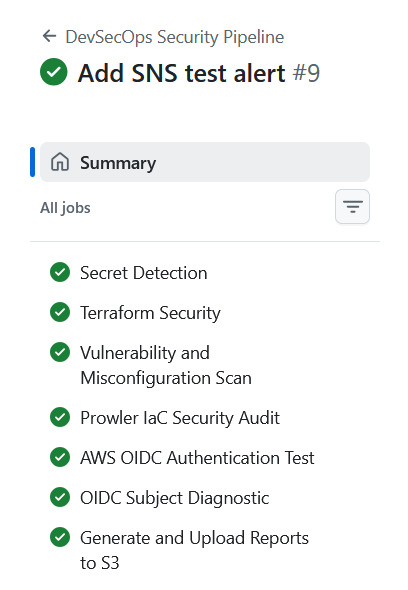
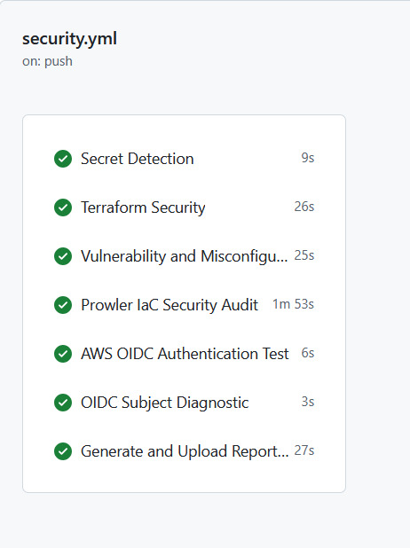
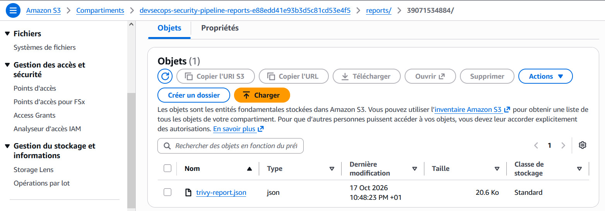
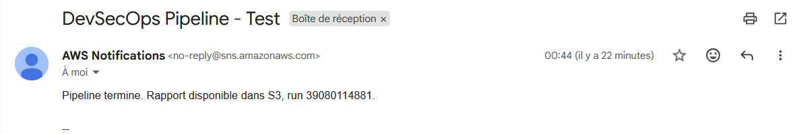

# DevSecOps Security Pipeline

Pipeline CI/CD de sécurité sur GitHub Actions, avec authentification
AWS sans clé d'accès (OIDC), stockage des rapports dans S3 et
alertes e-mail via SNS.

## Architecture

GitHub Actions -> (OIDC) -> Rôle IAM AWS -> S3 (rapports) + SNS (alertes)

## Outils

| Outil | Rôle |
|---|---|
| Gitleaks | Détection de secrets |
| Checkov | Sécurité du code Terraform |
| Trivy | Vulnérabilités et mauvaises configurations |
| Prowler | Audit de l'IaC |
| Terraform | Création du rôle IAM, du bucket S3 et du topic SNS |

## Sécurité

- Authentification OIDC : aucun secret AWS longue durée dans GitHub
- Rôle IAM limité au dépôt et à la branche main
- Bucket S3 privé et chiffré

## Résultats

### Pipeline GitHub Actions

### Rapport de sécurité stocké dans S3

### Alerte e-mail SNS

## Difficultés rencontrées

Le jeton OIDC contenait des identifiants numériques dans le claim `sub`.
La trust policy IAM attendait l'ancien format et refusait la connexion.
Après diagnostic du jeton avec un job dédié, la trust policy a été
corrigée dans Terraform.